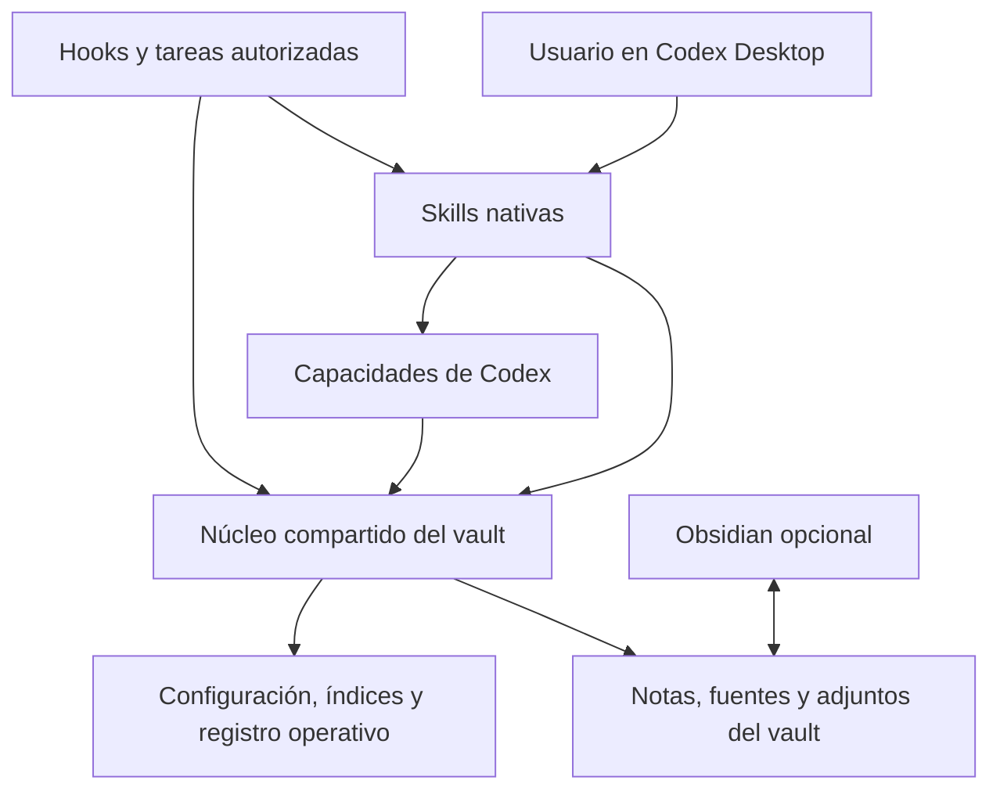

# Arquitectura de llm-wiki

## Contexto y límites del sistema

El producto busca ofrecer en Codex las capacidades completas de la referencia,
mediante skills nativas y un núcleo compartido. Codex Desktop es el entorno
principal de la primera entrega; el canal elegido es un marketplace agregado
desde GitHub/Git. Obsidian es opcional para operar los archivos del vault, y se
conservan sus formatos. Las integraciones se reevalúan por resultado bajo AC-019;
las brechas no se declaran resueltas por adoptar Codex.

- **Dirección de producto:** [Constitución vigente v003](CONSTITUTION.md); dirección aprobada en v001, base
  `eaa8e3075c482dc3fd9cb9864b50b34e668d97a0:docs/superpowers/CONSTITUTION.md`.
  Aplican PRI-001–PRI-005, OBJ-001–OBJ-003 y EXI-001–EXI-003.
- **Diagnóstico:** [inventario v001](analysis/inventario-codex/README.md), base
  `22fd2d36ea33415a8f44211ae346f2a775021553:docs/superpowers/analysis/inventario-codex/README.md`;
  sus anexos pertenecen al mismo commit. El inventario aporta evidencia, no
  aprobación de sus propuestas técnicas.
- **Referencia de implementación ajena al nuevo producto:** fork local
  `.repos/obsidian-second-brain`, commit `b0089f7666d0c1e3db41c9d587b6f3c997665235`.
  Sus fuentes están identificadas en el inventario. No se modifican ni se proponen
  como dependencia de ejecución del paquete instalado.
- **Estado actual:** núcleo y paquete propio implementados en `43ee802`; artefacto macOS y evidencia de recuperación en `619fecb`. Instalación CLI de 0.1.0-dev.2 verificada. Desktop y paridad funcional siguen pendientes.
- **Documentos relacionados:** [STRUCTURE.md](STRUCTURE.md) e [INFRASTRUCTURE.md](INFRASTRUCTURE.md) describen módulos, ejecución y límites observados; [evidencia](evidence/2026-10-08-implementation.md) registra pruebas.

## Componentes, interfaces y flujos implementados

MCP STDIO y CLI comparten `internal/service`. El registro mantiene identidad canónica por vault y asociaciones de proyectos; `vault` confina lectura y escritura, y coordina planes con journals y snapshots externos. Cada archivo se publica con precondiciones; un lote parcial tiene inspect/resume/rollback condicional. No se promete atomicidad global ni CAS frente a un editor que no respeta locks.

Grafo, salud, bootstrap, init, migración, merge y exportación trabajan sobre las notas canónicas. Búsqueda usa un índice léxico reconstruible en memoria; reindex reporta cambios y retrieval-eval recibe gold cases explícitos. No hay embeddings ni cliente de proveedor. Catálogo combina 48 skills del paquete y workflows personales; leer un workflow no lo ejecuta ni instala.

El paquete contiene un binario universal, manifiestos y checksums. Se ejecutó en arm64 sin toolchain de usuario; Intel y llamada desde Desktop no están acreditados. Razonamiento y web ocurren en Codex, no en el núcleo. Las brechas de host y vistas permanecen abiertas conforme la spec.

## Restricciones técnicas y atributos de calidad

| Restricción | Fuente de autoridad | Evidencia actual y límite |
|---|---|---|
| Conservar todas las capacidades, incluyendo calendario, captura remota y mantenimiento | PRI-001, OBJ-001 | Catálogo de 47 comandos y funciones adicionales; sin paridad demostrada |
| Experiencia centrada en Codex Desktop e instalación desde marketplace Git | AC-001 y AC-002 | Instalación CLI dev.2 verificada; aceptación Desktop pendiente |
| Operar sin Obsidian abierto y mantener sus formatos e integraciones | AC-003 | Operaciones sobre fixtures sin Obsidian; render/vistas pendientes |
| Reutilizar lógica útil con skills nativas y núcleo compartido | AC-004 | Assets y núcleo Go compartido implementados; interacción por modalidad pendiente |
| Conservar procedencia, historial y control sobre las escrituras | PRI-003, PRI-004, OBJ-003 | Hashes, bloqueo por vault y recuperación durable probados; límite ante editor externo documentado |
| Distinguir equivalencia funcional de empaquetado correcto | PRI-005, EXI-001 | Build de referencia excluye calendario y omite vault_ops requerido por indexación |

## Decisiones arquitectónicas

### ADR-001 — Codex Desktop como entorno principal

- **Elección:** diseñar la primera entrega para Codex Desktop.
- **Motivo:** concentra la experiencia de instalación, interacción y automatización.
- **Alternativas:** Desktop y CLI simultáneos; Desktop, CLI e IDE simultáneos.
- **Consecuencias:** las demás superficies no reciben promesa de compatibilidad en
  esta primera entrega; las capacidades funcionales siguen dentro de la meta.
- **Decision status:** approved
- **Fuente:** AC-001; no define sistemas operativos ni versiones mínimas.
- **Implementation state:** partially_implemented
- **Evidencia de implementación/verificación:** Instalación CLI y descubrimiento; Desktop pendiente. Ver registro de implementación.

### ADR-002 — Distribución desde marketplace Git

- **Elección:** permitir agregar un repositorio de marketplace en Complementos e
  instalar el plugin desde ese catálogo.
- **Motivo:** coincide con la experiencia de instalación solicitada por el usuario.
- **Alternativas:** copia manual de skills; publicación en el directorio público
  universal. Ninguna reemplaza el canal elegido.
- **Consecuencias:** habrá catálogo y paquete versionado; instalación y actualización
  deberán comprobarse desde un entorno limpio. Repositorio, referencias de release
  y automatización de publicación quedan sin elegir.
- **Decision status:** approved
- **Fuente:** AC-002. Marketplace Git y directorio público son canales diferentes;
  la elección no autoriza crear remotos, publicar ni instalar ahora.
- **Implementation state:** partially_implemented
- **Evidencia:** mecanismo descrito en la [documentación oficial de marketplaces](https://developers.openai.com/plugins/build/plugins), consultada el 2026-10-08; plugin propio no validado.

### ADR-003 — Vault independiente de la aplicación Obsidian

- **Elección:** operar sobre los archivos locales desde Codex sin exigir Obsidian
  abierto, conservando compatibilidad con notas, wikilinks, canvas y complementos.
- **Motivo:** conserva el enfoque de la referencia y permite usar Obsidian como
  interfaz complementaria.
- **Alternativas:** exigir la aplicación abierta; abandonar sus formatos e
  integraciones. No corresponden al enfoque aceptado.
- **Consecuencias:** las funciones visuales y el complemento lint de Obsidian se
  verifican en esa aplicación cuando corresponda; no se promete reemplazarlos con
  una interfaz nueva de Codex.
- **Decision status:** approved
- **Fuente:** AC-003.
- **Implementation state:** implemented
- **Evidencia de implementación/verificación:** Núcleo opera fixtures sin proceso Obsidian; vistas pendientes. Ver registro de implementación.

### ADR-004 — Skills nativas con núcleo compartido

- **Elección:** las skills conducen las tareas; un núcleo compartido gestiona acceso
  al vault, búsqueda, escrituras e integraciones. Hooks y automatizaciones utilizan
  las mismas operaciones. Se reutiliza el código útil del original.
- **Motivo:** evita trasladar caminos incompatibles de escritura y dependencias
  dispersas; preserva las capacidades conversacionales y las operaciones.
- **Alternativas:** conversión directa del original; reescritura total desde cero.
- **Consecuencias:** separar razonamiento del agente de operaciones deterministas;
  mantener trazabilidad de cada capacidad del inventario. No decide aún lenguaje,
  transporte, API, número de skills ni persistencia operativa.
- **Decision status:** approved
- **Fuente:** AC-004, limitada al enfoque presentado en el chat.
- **Implementation state:** implemented
- **Evidencia de implementación/verificación:** 48 assets + catálogo + servicios Go; aceptación de modalidades pendiente. Ver registro de implementación.

### ADR-005 — Go para la implementación propia del plugin

- **Elección:** implementar en Go el núcleo y las herramientas ejecutables propias
  del plugin: servidor MCP, utilidades internas y lógica
  de automatización. No conservar scripts Python como requisito de ejecución propio.
  Las skills y reglas siguen siendo documentos; la elección no exige convertir
  Markdown o los formatos del vault en código Go.
- **Motivo:** elección expresa del usuario para el conjunto de la implementación,
  sustituyendo la recomendación anterior de Python.
- **Alternativas:** reutilización directa de Python; combinación Go/Python;
  reimplementación en TypeScript. La elección actual descarta depender de Python
  para la lógica propia, aunque el original sirve como referencia de comportamiento.
- **Consecuencias:** portar y verificar los comportamientos inventariados. Reutilizar
  conceptos, formatos, casos de prueba y contratos donde corresponda, en lugar de
  copiar módulos Python para ejecutarlos. SDK, bibliotecas, versiones, binarios por
  plataforma y mecanismo de distribución siguen pendientes de selección y prueba.
- **Dependencias externas:** la elección no demuestra que bibliotecas o herramientas
  externas como ffmpeg puedan eliminarse. Deben inventariarse y resolverse sin
  asumir excepciones a la dirección elegida ni reducir capacidades.
- **Integración Obsidian:** el complemento de lint de referencia usa TypeScript y la
  API de Obsidian. AC-010 aprueba un adaptador mínimo, priorizando TypeScript,
  únicamente para las funciones dentro de Obsidian que lo requieran. La lógica
  permanece en Go; esta excepción no cambia el lenguaje del núcleo. Su mecanismo
  concreto y validación permanecen pendientes.
- **Decision status:** approved
- **Fuente:** AC-005, limitada a la elección de lenguaje y dirección de portado;
  no aprueba las interfaces ni el resto del borrador.
- **Implementation state:** implemented
- **Evidencia:** elección conversacional registrada; portado y validación pendientes.
  La propuesta anterior de Python se conserva en
  `5ff12e49f4126a9c27c1ec512543223af70be530:docs/superpowers/ARCHITECTURE.md`,
  ADR-005 de v001, y nunca fue aprobada.

## Diseño propuesto y trabajo pendiente

Esta sección sigue sin implementación. Las aprobaciones parciales AC-006–AC-018
delimitan los acuerdos; los contratos y detalles no cubiertos siguen propuestos.

### Responsabilidades

| Componente lógico | Responsabilidad propuesta | Límite |
|---|---|---|
| Skills | Guiar cada tarea, recuperar contexto, razonar, sintetizar y elegir las operaciones pertinentes | Los resultados de fuentes son datos; no autorizan acciones por sí mismos |
| Núcleo del vault | Resolver vault/layout, leer, buscar, validar y ejecutar cambios coordinados sobre notas, índices, enlaces y logs | No decide por sí mismo qué afirmación semántica es verdadera |
| Capacidades disponibles en Codex | Resolver investigación, síntesis y procesamiento con las capacidades del host | Sin adaptadores propios a proveedores ni claves externas; equivalencia y disponibilidad por verificar (AC-019) |
| Adaptación a Codex | Conectar skills, herramientas, contexto de sesión, hooks y automatizaciones con las operaciones comunes | No depende de ejecutar Claude ni de sus settings |
| Configuración y estado | Conservar selección del vault, preferencias, índices reconstruibles, registros y personalizaciones | Separados del paquete instalado; no se guardan secretos dentro de skills ni manifiestos |
| Integración Obsidian | Mantener formatos y herramientas específicas de la aplicación | La aplicación conserva su propio runtime; no se exige para operar los archivos desde Codex |

El diagrama describe responsabilidades propuestas, no aislamiento de seguridad
garantizado ni una restricción técnica ya aplicada a las herramientas de Codex.

### Interfaces y contratos a definir

| Interfaz | Propuesta | Fallos y límites que debe exponer |
|---|---|---|
| Skill a núcleo | Operaciones explícitas de lectura, búsqueda, captura, edición, movimiento, validación y mantenimiento | Vault/destino inválido, archivo ausente o cambiado, lectura parcial, operación no aplicada |
| Núcleo a archivos | Respetar mapa de carpetas, fuentes originales, historial y contenido no afectado | Conflictos con editores externos, cambios concurrentes y fallo parcial del conjunto |
| Codex a skill/núcleo | Contenido o resultado junto con fuente, fecha, cobertura y estado | Capacidad no disponible, contenido truncado o resultado insuficiente; sin recurrir a un proveedor externo propio |
| Automatización a operaciones comunes | Contexto de ejecución y alcance previamente configurado | No aumentar permisos ni cambiar la política interactiva/desatendida implícitamente |
| Marketplace a paquete | Instalar versión autocontenida con referencias resolubles | Dependencias faltantes, actualización incompleta y compatibilidad del host |

El transporte aprobado para skill a núcleo es MCP local por STDIO;
un CLI interno puede servir a hooks y diagnóstico reutilizando la misma lógica.
AC-009 aprueba STDIO. El CLI interno continúa propuesto: la respuesta del usuario
se limita expresamente a STDIO. Los nombres y contratos de herramientas siguen
pendientes de diseño; el SDK oficial es una recomendación técnica, no una
dependencia ya seleccionada y probada.

### Flujos y fuentes canónicas

1. **Consulta:** resolver el vault, leer sus convenciones y buscar con cobertura
   explícita; la skill redacta la respuesta citando notas y señalando límites.
   Las notas son la fuente del conocimiento; un índice es una ayuda reconstruible.
2. **Captura y actualización:** la skill determina contenido y destinos dentro de
   la autorización aplicable; el núcleo valida y ejecuta los cambios, incluyendo
   enlaces, índice y log cuando el workflow los prescribe.
3. **Investigación:** Codex recupera fuentes o medios con sus capacidades disponibles; la skill sintetiza;
   el núcleo conserva originales nuevos y aplica el resultado derivado. No modifica
   fuentes originales existentes. AC-019 elimina la obligación de conservar proveedores externos. Las modalidades
   deben evaluarse por resultado; no se afirma equivalencia hasta comprobarla.
4. **Mantenimiento:** las rutinas reutilizan operaciones comunes y conservan la
   distinción original: reconciliación interactiva puede resolver casos claros;
   la rutina nocturna registra conflictos abiertos y no los resuelve reescribiendo
   páginas. Dry-run y ofertas opcionales permanecen donde corresponden.
5. **Actualización del plugin:** reemplazar el paquete no reemplaza el conocimiento,
   las preferencias ni las extensiones del usuario. La migración, si hace falta,
   tendrá un alcance explícito y verificable.

Para cambios compuestos propongo un registro de operación con archivos afectados,
estado previo y resultado, que permita detectar modificaciones concurrentes y
recuperar fallos. No se afirma una transacción atómica entre múltiples archivos ni
entre el vault y servicios externos. El formato, la retención, las precondiciones
y el procedimiento de recuperación quedan pendientes de diseño y aprobación.
El registro técnico no añade una confirmación humana nueva a cada escritura.

### Condiciones para verificar la propuesta

- Mantener correspondencia con todos los registros F/I/T del inventario, incluyendo
  modos y efectos opcionales/automáticos; las filas no son un porcentaje de paridad.
- Verificar instalación y actualización reales desde marketplace en Codex Desktop.
- Probar dependencias desde el paquete instalado, sin acceso accidental a `.repos`.
- Comprobar lectura, propagación, conflictos y recuperación sobre vaults de prueba
  con ambos layouts y contenido humano preexistente.
- Verificar por separado integración MCP, confianza y eventos de hooks, tareas
  programadas y experiencia de Obsidian. Reevaluar las capacidades originalmente
  ligadas a proveedores, calendario y Telegram bajo AC-019, sin implementar
  conectores externos para cerrar brechas.
- Conservar las diferencias entre pruebas de empaquetado, funcionamiento y
  resultados de usuario definidas en EXI-001–EXI-003.

## Asuntos abiertos

| Decisión o evidencia faltante | Cómo resolverla | Responsable |
|---|---|---|
| Runtime y dependencias Go | Seleccionar SDK MCP, bibliotecas y distribución por plataforma; lenguaje ya decidido en ADR-005 | Diseño posterior con evidencia técnica |
| Integración lint de Obsidian y herramientas externas | Adaptador mínimo TypeScript aprobado por AC-010; resolver y validar el mecanismo y las dependencias externas | Usuario promotor con apoyo técnico |
| Transporte y límites del núcleo | STDIO aprobado por AC-009; precisar CLI y contratos | Usuario promotor con apoyo técnico |
| Coordinación de escrituras y recuperación | Precisar precondiciones, concurrencia, registro y fallos externos | Diseño posterior dentro del enfoque acordado |
| Dependencias y compatibilidad Desktop | macOS primero y binarios precompilados aprobados; definir versiones, arquitecturas y configuración | Usuario promotor con evidencia del host |
| Equivalencia usando solo Codex | AC-019 descarta integraciones externas y sus claves; comprobar alternativas por capacidad y registrar brechas | Diseño y validación técnica |
| Paquete, personalizaciones y publicación | Definir versiones, ubicación del estado, extensión y repositorio de marketplace | Diseño posterior; publicación no autorizada por este documento |

AC-008 delimita macOS como primera plataforma de validación; otras plataformas
no se declaran soportadas sin pruebas. La selección
del lenguaje tampoco determina el formato de notas, la disponibilidad offline ni
las credenciales de proveedores. Esos límites deben definirse expresamente.

## Historial de decisiones y cambios

Las declaraciones siguientes se conservan desde este chat, sin enlace recuperable.
Registran decisiones conversacionales concretas; no constituyen aprobación de los
detalles nuevos de este borrador. El documento completo permanece en draft.

| ID | Fecha | Declaración y contexto | Alcance |
|---|---|---|---|
| AC-001 | 2026-10-08 | «Avancemos con Codex Desktop.», respuesta a elegir el entorno principal de la primera entrega | ADR-001 |
| AC-002 | 2026-10-08 | «Me gustaría que fuese un plugin instalable desde marketplace.», con captura de Agregar marketplace desde GitHub/URL de Git | ADR-002; no es petición de publicación en el directorio público |
| AC-003 | 2026-10-08 | «Si, me gusta ese enfoque.», tras proponer operar desde Codex sin exigir Obsidian abierto, manteniendo formatos e integraciones | ADR-003 |
| AC-004 | 2026-10-08 | «Si, avancemos con ese enfoque.», tras recomendar skills nativas, núcleo compartido, reutilización de código y operaciones comunes para hooks/automatizaciones | ADR-004; no decide lenguaje ni contratos todavía no presentados |
| AC-005 | 2026-10-08 | «Yo avanzaría todo con Go.», en respuesta a la propuesta de Python para el núcleo de v001, presentada en `5ff12e49f4126a9c27c1ec512543223af70be530:docs/superpowers/ARCHITECTURE.md` | Selecciona Go para la implementación propia. Sustituye la propuesta Python; no aprueba todo el documento ni autoriza implementación |

| Fecha | Versión | Cambio y fundamento | Fuente |
|---|---|---|---|
| 2026-10-08 | v001 | Primer borrador: registra acuerdos y propone responsabilidades, flujos y decisiones pendientes | Constitución e inventario fijados arriba; AC-001–AC-004 |
| 2026-10-08 | v002 | Cambia ADR-005 a Go por decisión del usuario; explicita portado y pendientes de integración y dependencias | AC-005; base previa exacta `5ff12e49f4126a9c27c1ec512543223af70be530:docs/superpowers/ARCHITECTURE.md`; ADR-001–ADR-004 conservan su alcance |

## Aprobaciones parciales de las recomendaciones consolidadas

Fuente: anotaciones del usuario sobre el mensaje
`msg_0a9075ab2a4808b2016ac7e44b7700819183e30367bef0e6ba`,
2026-10-08. La propuesta fue conversacional; no se atribuye una presentación
Git previa inexistente a esa tabla. Base documental previa preservada:
`6d60342319a4a2d34262eade12d7e8b9e17b11ae:docs/superpowers/ARCHITECTURE.md`.
Responsable de las decisiones: usuario promotor del proyecto. Todas las
implementaciones y verificaciones siguen pendientes. La arquitectura completa
permanece en draft; estas decisiones tienen el alcance indicado.

| ID | Anotación | Declaración literal | Alcance |
|---|---|---|---|
| AC-006 | 1 | «Aprobado el nombre `llm-wiki`» | Nombre aprobado; no confirma por asociación la identidad nominal del responsable. |
| AC-007 | 2 | «Si, aprobado.» | Referencia de equivalencia v0.17.0, commit b0089f7666d0c1e3db41c9d587b6f3c997665235; novedades futuras se evalúan por separado. |
| AC-008 | 3 | «Si, avancemos para MacOS.» | macOS primero; preparar portabilidad sin declarar soporte adicional no probado. |
| AC-009 | 4 | «Aprobado STDIO» | MCP local por STDIO aprobado; no atribuye aprobación explícita del CLI ni del SDK. |
| AC-010 | 5 | «Me parece bien. Prioricemos Typescrypt.» | Adaptador mínimo Obsidian con preferencia TypeScript; lógica y núcleo Go. No es una migración general a TypeScript. |
| AC-011 | 6 | «Aprobado.» | Binarios precompilados sin exigir Go; dependencias de medios configuradas al utilizar la función, con diagnóstico. |
| AC-012 | 7 | «No entiendo esto.» | Pendiente: explicar proveedores, claves y sustituciones. No hay aprobación. |
| AC-013 | 8 | «Si, aprobado.» | Operaciones locales sin servicios externos donde corresponda; red para investigación, transcripción remota y razonamiento Codex. |
| AC-014 | 9 | «Dale.» | Markdown canónico, índices reconstruibles, configuración/secretos/extensiones fuera del paquete; vault explícito por proyecto. |
| AC-015 | 10 | «Aprobado,» | Detección de concurrencia, registro recuperable y parada ante conflicto; sin confirmación nueva por escritura ni atomicidad global prometida. |
| AC-016 | 11 | «Me parece bien.» | Horarios expresamente activados; preservar separación interactiva/desatendida y conflictos nocturnos sin reescritura resolutiva. |
| AC-017 | 12 | «Si, aprobado.» | Catálogo Git, versiones identificables y retorno a anterior; verificar instalación/actualización. Publicación y visibilidad pendientes. |
| AC-018 | 13 | «Dale.» | Entregas verificables, alcance final completo, paridad por capacidad/modalidad, pruebas de continuidad y recuperación. |

Mantenimiento v003: registra aprobaciones parciales, reconcilia la excepción
TypeScript, STDIO y macOS; no autoriza por asociación detalles no presentados.

## AC-019 — Codex resuelve las tareas sin integraciones externas propias

- **Fecha y responsable:** 2026-10-08, usuario promotor.
- **Declaración literal:** «Yo no integraría otras herramientas. Quiero que todo lo resuelva Codex.»
- **Estado de decisión:** approved, sobre la dirección expresada en el chat.
- **Alcance:** no construir adaptadores a otros proveedores, solicitar sus claves
  ni introducir otros servicios o conectores como solución a las tareas. Utilizar
  las capacidades disponibles en Codex. Resuelve AC-012 y sustituye la propuesta
  de mantener proveedores externos opcionales.
- **Núcleo propio:** Go/MCP local conserva las operaciones deterministas del vault;
  Codex conduce el razonamiento y los workflows. No es otro proveedor de IA.
- **Límites:** no demuestra que Codex pueda reproducir cada integración original.
  Inventariar equivalencias y brechas por resultado, especialmente medios, X,
  calendario y Telegram. No ocultar pérdidas ni agregar dependencias externas
  para resolverlas sin una nueva decisión. El adaptador opcional Obsidian
  previamente aprobado y las dependencias de medios requieren reconciliación
  con esta restricción antes de implementarse; no se dan por necesarias.
- **Implementación y verificación:** pendientes. La arquitectura sigue en draft.

Base anterior preservada: `5d42830ea1b8ff5f844935e0277807a3db39e825:docs/superpowers/ARCHITECTURE.md`.

## Diseño técnico para la ejecución solicitada

El usuario autorizó avanzar análisis, diseño/plan e implementación/verificación
con subagentes Luna, en su anotación sobre el mensaje
`msg_0a9075ab2a4808b2016ac7effa1c70819185bf4224b6038e7a`:
«Dale, avanza con estas 4 usando subagentes luna.» Se conserva esa autorización;
los contratos nuevos siguientes se presentan como propuesta técnica, sin ampliar
el alcance a proveedores externos. Base anterior:
`f27672f7a63039805784efd8ccd5478b089dda2e:docs/superpowers/ARCHITECTURE.md`.

### ADR-006 — API local y mutaciones coordinadas (proposed)

Servidor Go con SDK oficial MCP, sin HTTP ni clientes de IA. Los nombres públicos
se normalizan a `wiki_*`; el catálogo enlaza los 12 nombres originales con los
equivalentes. Un CLI mínimo reutiliza estos servicios para diagnóstico y recovery.
Alternativa descartada para la propuesta: duplicar lógica de escritura en scripts
y MCP, porque impediría aplicar consistentemente las precondiciones.

Contratos propuestos, expresados en campos JSON:

| Operación | Entrada | Salida/condición |
|---|---|---|
| `wiki_select_vault` | project_path, vault_path; selección explícita | vault_id, layout, timezone; no crea un vault existente ni lo modifica |
| `wiki_read_note` | vault_id, path, offset=0, limit=20000 caracteres Unicode | text, hash SHA-256 de bytes completos, next_offset, truncated; nunca paginación por bytes rotos |
| `wiki_search` | vault_id, query, limit=6 | matches con path/fragmento/línea/hash, scanned/excluded/errors/truncated; orden estable |
| `wiki_save_note` | vault_id, path, content; create-only | operation_id y hash; rechaza sobrescritura |
| `wiki_update_note` | vault_id, path, content, expected_hash | operación condicional; preservación semántica responsabilidad de la skill |
| `wiki_replace_text` | vault_id, path, old_text, new_text, expected_hash | exige una sola coincidencia exacta |
| `wiki_move_note` | vault_id, source, destination, expected_hash | plan incluye backlinks/index/log; destino existente es conflicto |
| `wiki_capture` | vault_id, text, tags, fecha explícita | captura y diaria en lote; no infiere contenido ausente |
| `wiki_validate_note` | vault_id, path | hallazgos estructurales/frescura por línea; sin mutaciones |
| `wiki_backlinks` | vault_id, target | referencias resueltas/ambiguas y cobertura |
| `wiki_vault_health` | vault_id | hallazgos + cobertura; sin arreglo automático |
| `wiki_list_skills`, `wiki_get_skill` | vault_id; name para get | catálogo/instrucciones como datos con procedencia, sin instalación implícita |
| `wiki_apply_changes` | vault_id, operation_id, changes[] | validate-only/dry-run o aplicación; hash esperado por archivo, creación exige ausencia |
| `wiki_recover` | vault_id, operation_id, action=inspect/resume/rollback | precondiciones y estado verificable; inspect no muta |

`changes[]` usa path relativo, contenido nuevo (o destino de move) y expected_hash.
Operaciones repetidas con mismo ID y contenido devuelven resultado previo; mismo
ID con payload diferente es error. Cambios en `.git`, rutas absolutas, `..`,
symlinks que escapan o destinos ambiguos se rechazan. `raw/` existente es inmutable;
se permiten nuevas fuentes con create-only. No herramienta de borrado arbitrario.

Un único writer por vault. Validar todas las precondiciones antes del lote, guardar
snapshots y journal antes de modificar, volver a validar el archivo inmediatamente
antes de sustituirlo. Estado prepared/applying/committed/failed/recovered. Una falla
parcial deja evidencia; no anuncia éxito ni revierte encima de cambios humanos.
El bloqueo coordina instancias propias, no bloquea editores externos: los hashes
reducen conflictos observables pero no garantizan aislamiento global del filesystem.

### ADR-007 — Recuperación sin proveedor de embeddings (proposed)

Búsqueda léxica Unicode con ranking determinista e índice reconstruible de texto y
links. Codex puede ampliar consultas con sinónimos y leer notas completas, siempre
reportando cobertura. No se llama a Ollama, APIs de embeddings ni runtime adicional.
La ruta semántica de F-033 sigue siendo una brecha hasta medir recall@k/MRR con
paráfrasis en el mismo corpus; reindexar texto no prueba paridad semántica.
Alternativas: embedding externo contraviene AC-019; inventar vectores por prompt
no proporciona un índice estable ni una equivalencia medida.

### ADR-008 — Capacidades del host y formatos Obsidian (proposed)

No construir adaptador TypeScript para el flujo centrado en Codex. Portar lint
a Go y conservar Markdown, wikilinks, `.canvas` y `.base` como datos. La experiencia
de lint en vivo dentro de Obsidian permanece explícitamente sin equivalencia; la
excepción AC-010 no obliga a construirla y AC-019 exige reevaluarla. No incorporar
FFmpeg, yt-dlp ni servicios de transcripción. Medios se procesan únicamente cuando
Codex tenga una capacidad comprobada o el usuario proporcione transcripción/frames;
esto último es una entrada alternativa, no la misma extracción automática.

Un workflow puede consultar las capacidades disponibles en la sesión, pero el
plugin no promete que sus herramientas internas se llamen igual o existan en
otra cuenta. Ausencia produce `capability_unavailable`, detalle de lo no realizado
y opciones de entrada manual, nunca un resultado ficticio. No usar navegador o
plugins adicionales como sustitución oculta de integraciones prohibidas.

### Compatibilidad y medición

Las matrices de [equivalencias](analysis/equivalencias-codex/README.md) conservan
47 registros F, 12 I y 44 T, con solapamientos: no son 103 funciones distintas.
No se elimina ningún registro para mejorar cobertura. Cada modalidad recibe
proposed/implemented/verified/blocked y evidencia; un test de presencia de skill
no verifica su resultado. Los tests de continuidad y recovery requieren dos
sesiones/procesos y fallo inducido respectivamente. Los umbrales de resultados
con usuarios se mantienen abiertos; no se sustituyen por recuentos de tests.

### Referencias actuales

- [Empaquetado oficial](https://developers.openai.com/plugins/build/plugins):
  catálogo y manifiestos; consultado 2026-10-08. Validación del host sigue pendiente.
- [Skills oficiales](https://developers.openai.com/plugins/concepts/skills):
  instrucciones de workflow alrededor de herramientas; no implementan capacidades
  por sí solas.
- Código de referencia: `scripts/eval/semantic_search.py` declara backend Ollama
  local u OpenAI-compatible; se inspeccionó directamente, no se ejecutó.

## Especificación funcional y plan actuales

La [spec funcional v001](specs/2026-10-08-codex-plugin-spec.md) define historias
y aceptación, separadas de los contratos técnicos. El [plan v003](plans/2026-10-08-codex-plugin.md)
depende de su base exacta. Sus metadatos y AP-001 registran aprobación del alcance
previo; sus referencias fijadas no se sustituyen por esta propuesta. ADR-009 no
está incorporado a esa aprobación ni autoriza nuevas tareas de implementación.
Referencias comprobadas el 2026-10-09 sobre la base documental de v007.

## Propuesta de integración de áreas definidas por el usuario

### Fuentes, autoridad y alcance de v007

- **Base exacta inspeccionada:** `e703e1f9d898ccc797cb2d7eeed1ee4e68a3ee04`,
  con árbol de trabajo limpio antes de esta edición. Sus versiones completas de
  `docs/superpowers/CONSTITUTION.md` (v003, approved), `ARCHITECTURE.md` (v006,
  draft), `STRUCTURE.md` (v002, draft) e `INFRASTRUCTURE.md` (v002, draft) coinciden
  con los archivos leídos. No se altera ninguna declaración histórica.
- **Dirección aplicable:** PRI-003, PRI-004 y PRI-005; OBJ-002 y OBJ-003;
  EXI-002 y EXI-003 de la constitución v003 en esa base. El control de la
  organización y la continuidad ya están cubiertos; no se propone cambiar la
  misión, añadir objetivos ni ampliar las aprobaciones constitucionales.
- **Fuente de necesidad:** conversación [Evaluar estructura de bóvedas](thread://01a121c1-b35b-7b70-a7eb-7520f256b4ec?hostId=local),
  ocho intercambios leídos. El usuario pidió ubicar las áreas dentro de `wiki/`
  y finalmente: «Quiero que la creación de áreas sea agnostica». El brief final
  es una propuesta del asistente; no consta aprobación posterior de sus detalles.
  El ejemplo de la carrera fue una simulación, sin escrituras ejecutadas.
- **Encargo actual:** preparar una propuesta documental el 2026-10-09. Estado
  de ADR-009: proposed; implementación de la gestión específica: not_implemented;
  verificación de sus resultados: pendiente. La inspección de código es estática,
  no una prueba del paquete instalado, del host ni de dos sesiones reales.

### Estado actual comprobado

En la base anterior, `internal/vault/layout.go` no define ni normaliza el tipo
`area`; `internal/vault/bootstrap.go` no crea áreas. El mapa acepta solo los
tipos reconocidos: añadir una fila `area` al manual no basta hoy para exponerla
en `Layout.Folders`. Se pueden guardar notas Markdown en una ruta explícita
mediante las operaciones generales; eso no demuestra clasificación por áreas.

`internal/graph/links.go` elimina el frontmatter antes de extraer referencias.
Un campo YAML `area` o `areas` con wikilinks no produce por sí solo backlinks
en el grafo actual. Los enlaces en el cuerpo sí forman parte de su análisis.
`internal/service/service.go` ofrece búsqueda léxica por vault, lectura de
metadata, contexto y lotes recuperables, pero no una consulta específica de áreas.
`plugins/llm-wiki/skills/wiki-obsidian-project/SKILL.md` prescribe proyecto,
tablero, diaria e índice; no prescribe aún la relación con áreas.

### ADR-009 — Áreas como notas opcionales y relaciones explícitas (proposed)

- **Elección propuesta:** conservar las notas por tipo y representar cada área
  mediante una nota Markdown definida por el usuario. Un área expresa un ámbito
  o responsabilidad continua; un proyecto expresa un resultado delimitado. No
  fijar nombres, cantidad ni categorías del usuario en el producto.
- **Justificación:** permite revisar ámbitos y relacionar conocimiento entre
  sesiones sin mantener copias por cada área ni convertir cada ámbito en un vault.
- **Alternativas:** carpetas por área ofrecen navegación física, pero fuerzan
  una ubicación principal y encarecen reclasificar; tags son livianos, pero no
  reúnen propósito y contexto; notas enlazadas permiten ambas cosas y reutilizan
  las operaciones existentes. Se recomienda esta última opción.
- **Consecuencias:** la clasificación semántica queda en Codex; el runtime
  resuelve rutas, inventario y controles deterministas. No se promete organización
  en segundo plano, búsqueda federada ni un filtro semántico por área.
- **Autoridad:** pendiente de aprobación del usuario promotor sobre esta versión.
  La preferencia conversacional no aprueba los contratos técnicos añadidos aquí.

#### Contrato de organización propuesto

1. Extender el mapa con el tipo `area`. Predeterminados propuestos: `wiki/areas/`
   para wiki y `Areas/` para Obsidian. Un mapa explícito válido prevalece; no se
   mueve contenido por cambiar el mapa. Layout ambiguo o destinos incompatibles
   requieren resolución antes de escribir.
2. La nota de área usa `type: area` y las convenciones AI-first existentes;
   conserva nombre visible, propósito conocido, procedencia y enlaces pertinentes.
   La falta de propósito u objetivos queda pendiente, sin inventarlos. El nombre
   visible no se interpreta como una ruta: su representación segura como archivo
   se muestra al usuario cuando requiera ajuste; una colisión no sobrescribe.
3. La relación canónica se expresa como wikilinks en el cuerpo de la nota
   relacionada, en una sección de áreas o en la sección existente acordada en el
   manual. Admite cero, una o varias áreas. No se exige área principal ni un campo
   YAML singular. Los enlaces del índice del área son navegación derivada; no
   crean otra copia de la nota. Los metadatos humanos existentes se conservan y
   no se convierten automáticamente.
4. Crear un área crea su nota y los padres necesarios para ese destino, junto
   con los enlaces de navegación prescritos. No crea ramas por área en proyectos,
   raw, tareas o los demás directorios; tampoco altera la ruta de las diarias.
5. Un vault sin áreas continúa funcionando. Bootstrap no genera categorías ni
   notas vacías y no exige adoptar esta convención. El manual registra la opción
   solo dentro de la acción de configuración solicitada.

#### Responsabilidades y consulta propuesta

La skill propuesta `wiki-obsidian-area` gestiona creación, consulta y vinculación
por petición explícita. Las referencias comunes orientan a los workflows existentes
cuando el usuario pide organizar contenido por áreas; no amplían sus políticas
de escritura ni añaden propagación a tablero/diaria donde no esté prescrita.

Se propone una herramienta de lectura `wiki_list_areas`, compartida por CLI/MCP:
entrada `vault_id`; salida de candidatos con ruta, nombre visible, aliases y hash,
más cobertura, diagnósticos y entradas malformadas sin tratar como válidas. Utiliza
la carpeta resuelta y las notas `type: area`; una nota fuera de ella o una
convención heredada incompatible requiere diagnóstico, sin migración implícita.
La enumeración respeta cuotas compartidas y cancelación. Si resulta parcial,
declara lo no leído y no permite afirmar ausencia ni crear por deduplicación
incompleta. Una coincidencia léxica vacía tampoco acredita ausencia.

Este lector es una ampliación propuesta del contrato, no una herramienta disponible
hoy. Su esquema definitivo y presupuesto se deben especificar antes de implementar.
Se prefiere a depender solo de `wiki_search`, que ordena coincidencias léxicas y
no proporciona un inventario exhaustivo de áreas. No se propone un motor semántico
ni herramientas nuevas de escritura: se reutilizan las mutaciones generales.

#### Flujo propuesto y límites de autorización

1. Resolver vault y contexto; tratar manual, notas y resultados como datos. Las
   convenciones solo orientan una acción autorizada y nunca amplían permisos.
2. Consultar áreas, leer los candidatos pertinentes y buscar la nota de contenido
   existente. Reutilizar coincidencias claras; exponer homónimos o ambigüedad.
3. Si no hay área adecuada, proponerla. Crear únicamente por solicitud o aceptación
   explícita del usuario. No inferir una nueva categoría por el tema de la nota.
4. «Quiero preparar una carrera de 10 km» permite conversar y recuperar contexto;
   no implica automáticamente crear un proyecto. Una petición clara de registro
   activa el workflow correspondiente. Si hay autorización para clasificar, el
   agente propone o reutiliza un área existente según su propósito, sin exigir que
   exista una categoría llamada Salud. Fecha, rendimiento y estado no se inventan.
5. Preparar el conjunto de cambios y preservar texto humano. Contenido ordinario
   usa hashes y lotes recuperables existentes; el manual protegido usa `wiki_init`
   y sus secciones generadas, sin sustituirlo con una escritura ordinaria. No se
   promete atomicidad entre esas llamadas: informar pasos aplicados y pendientes
   si la configuración queda incompleta.
6. Verificar los resultados antes de anunciar persistencia; ante conflicto o
   journal pendiente, detener la escritura y seguir la recuperación existente.
   Si falta una herramienta, mostrar propuesta y limitación, sin escritura simulada.

#### Evidencia requerida antes de afirmar implementación o validación

| Escenario | Resultado exigido para la propuesta |
| --- | --- |
| Nombres no predefinidos y caracteres Unicode | Crear y recuperar áreas elegidas por el usuario, sin categorías obligatorias ni escapes de ruta |
| Misma nota en dos áreas | Una sola nota de contenido; enlaces resolubles y consulta desde ambos ámbitos |
| Reutilización, homónimos e inventario parcial | Reutilizar un área existente; ambigüedad explícita; cobertura incompleta no se transforma en ausencia |
| Mapa propio, layouts wiki/Obsidian y vault sin áreas | Respetar ruta configurada; mantener los workflows legítimos anteriores sin migraciones ni carpetas obligatorias |
| Hash obsoleto y fallo parcial | Rechazo o recuperación verificable, con texto humano conservado y sin éxito global ficticio |
| Segundo proceso y segundo chat | Recuperar áreas y relaciones desde datos persistidos; distinguir evidencia del runtime de aceptación real en Codex |

Estos escenarios apoyan EXI-002 y EXI-003; no son mediciones realizadas ni sustituyen
la aprobación de una especificación y plan del incremento. Una entrega de producción
necesitará además paquete reconstruido y evidencia de distribución correspondiente.

#### Asuntos abiertos y documentos afectados

- Aprobar o corregir ADR-009, especialmente rutas predeterminadas, relaciones en
  el cuerpo y la incorporación de `wiki_list_areas`.
- Fijar el esquema del lector, tratamiento de notas heredadas y representación
  segura de nombres; no ejecutar una conversión masiva como parte de la creación.
- Renombrado, archivo, fusión y eliminación de áreas no se definen en este
  incremento; no hay permiso implícito para realizarlos ni migraciones automáticas.
- [STRUCTURE.md](STRUCTURE.md), v004, localiza cambios futuros sin duplicar esta
  decisión. [INFRASTRUCTURE.md](INFRASTRUCTURE.md), v002, sigue describiendo la
  persistencia y recuperación existentes: no se requieren servicios, estado nuevo,
  schedulers ni conectores por esta propuesta.
- La constitución v003 permanece sin cambios. Spec y plan previos conservan
  AP-001 y sus bases exactas; esta revisión no los amplía ni reescribe sus tareas.
  La ubicación/prioridad de una futura entrega sigue pendiente, sin crear roadmap.

### Historial de la propuesta

2026-10-09, v007: incorpora ADR-009 como propuesta documental y reconcilia el
estado referenciado de spec/plan previo según sus metadatos. Base anterior exacta:
`e703e1f9d898ccc797cb2d7eeed1ee4e68a3ee04:docs/superpowers/ARCHITECTURE.md`.
Conserva aprobaciones parciales y registros históricos; no registra aprobación,
implementación, instalación ni validación de la gestión de áreas.

## Propuesta ampliada: aplicación transversal en las carpetas wiki

### Alcance y fuente de v008

Esta revisión desarrolla los cuatro puntos seleccionados por el usuario en la
anotación sobre `msg_0eb917ea2afbbbf3016ac943036a8881918b5dc5f5da1c23b9`:
consulta/vinculación de áreas en workflows; tratamiento de OKRs y entidades;
enlaces en el cuerpo; validación de pertenencia múltiple sin duplicación ni
reorganización. «Entendido. Elabora una propuesta nueva basada en estos items»
autoriza esta propuesta documental, no su implementación. «Perfecto» precedió
una petición de verificación: no se registra como aprobación de contratos nuevos.

Base exacta: `16da4583ab65a124d461cfdd41470020cb8a8073`, arquitectura v007 y
estructura v003, con árbol limpio antes de editar. La inspección estática de
`internal/vault/layout.go`, `bootstrap.go`, `internal/graph/links.go`,
`internal/service/service.go` y las skills de proyecto, persona, captura, tarea,
save, daily, log, review y calendar confirma los límites descritos abajo.
No hay nueva evidencia de ejecución, instalación ni continuidad real.

La constitución v003 de esa base permanece approved y sin cambios: aplican
PRI-003–005, OBJ-002–003 y EXI-002–003. Esta ampliación concreta esos resultados,
sin crear otra misión, objetivo o principio. ADR-009 sigue proposed y conserva
su registro canónico; los apartados siguientes amplían su integración. ADR-010
registra exclusivamente la decisión de resolución de tipos y destinos.

### Integración transversal propuesta de ADR-009

La relación con áreas es opcional y se activa por petición del usuario o una
convención previamente adoptada dentro del alcance de la escritura solicitada.
La ausencia de esa convención mantiene el comportamiento previo. Leer un manual
no habilita por sí solo clasificación, propagación ni automatizaciones nuevas.

Antes de vincular, usar el lector de áreas propuesto, leer propósito/candidatos y
resolver coincidencias. Reutilizar relaciones existentes; una ambigüedad queda
pendiente. La clasificación semántica corresponde al agente; el runtime no
deduce un área por carpeta, tag, nombre o parentesco con un proyecto. Si sugiere
heredar las áreas de un proyecto, debe comprobar pertinencia y autorización.
No crear un área ausente por inferencia ni trasladar notas para clasificarlas.

| Tipo y carpeta predeterminada wiki | Workflow afectado | Integración propuesta |
| --- | --- | --- |
| Proyecto, `wiki/projects/` | project, projects y save | Enlazar áreas pertinentes en el proyecto único; su overview puede recuperar esas relaciones sin reclasificar ni mover |
| Idea/concepto, `wiki/concepts/` | capture, synthesize, distill y save | Reutilizar nota existente y enlazar áreas sustentadas; mantener procedencia y umbrales propios de cada workflow |
| Entidad, `wiki/entities/` | person y save | Mantener una ficha por entidad; admitir áreas múltiples sin convertir cada vínculo en una ficha nueva |
| Tarea, `wiki/tasks/` o tarjeta | task y save | Nota sustancial con enlaces en su cuerpo; tarea breve con enlaces dentro de su tarjeta, sin crear nota solo para añadir área |
| Reunión, `wiki/meetings/` | calendar, modo meeting | Enlazar desde la nota con datos aportados o comprobados; no requiere acceso externo para el caso local |
| Decisión, `wiki/decisions/` | save y workflows que registren decisiones | Preservar nota o sección existente, motivos y procedencia; relacionar esa unidad sin duplicarla ni forzar una nueva nota |
| OKR, `wiki/okrs/` | Workflow de OKR propuesto y save | Objetivo/resultados vinculados con áreas; no inventar métricas, línea base, metas, responsables ni fechas |
| Diaria, `wiki/daily/` | daily y propagaciones prescritas | Mantener diario común por fecha; enlazar áreas en entradas pertinentes sin generar un diario por área |
| Log, `wiki/logs/` | log y save | Conservar log de proyecto/fecha e historial; enlazar áreas pertinentes sin nuevos registros paralelos |
| Revisión, `wiki/reviews/` | review | Recuperar relaciones dentro del periodo y cobertura existentes; la revisión por área solo se ejecuta si se pide, sin cambiar el periodo ni inventar actividad |

El nuevo workflow de OKR es una extensión propuesta, no una skill ya disponible
ni un reemplazo del tablero del preset executive. Debe permitir registrar o
consultar objetivos con información pendiente explícita. Solo actualiza un
tablero o índice cuando esa propagación forme parte del workflow adoptado.
El flujo person conserva su finalidad; save puede registrar organizaciones y
herramientas con los tipos y destinos de ADR-010, sin prometer un workflow
específico de organizaciones o herramientas que aún no existe.

### Relaciones, formatos y compatibilidad

- Mantener la decisión de ADR-009: enlaces canónicos en el cuerpo de la unidad
  registrada; cero o varias áreas, sin área principal obligatoria. Una sección
  existente apropiada prevalece sobre generar encabezados redundantes.
- En tableros Kanban, insertar enlaces en la tarjeta o en la nota relacionada;
  nunca añadir un encabezado que el plugin interprete como columna nueva.
- No modificar fuentes `raw/` para añadir backlinks o áreas. La nota derivada
  puede enlazar la fuente y las áreas; el original permanece intacto.
- No usar un campo YAML `areas` como sustituto de los enlaces del cuerpo: el
  grafo actual descarta frontmatter. Conservar campos humanos heredados e informar
  su limitación; convertirlos exige una petición aparte. Esta propuesta no amplía
  el parser de grafo para interpretar metadata ni redefine `relations:`.
- Consultar backlinks para navegación desde un área. Un índice explícito de área
  es opcional y derivado; actualizarlo únicamente dentro de la escritura autorizada,
  sin reconstruir toda la bóveda cada vez. Resultados parciales conservan cobertura.
- Mantener hashes, controles de rutas y recuperación de ADR-009. Las convenciones
  no crean una autorización general para tocar otras notas, tableros o el manual.

### ADR-010 — Tipos explícitos para OKRs y entidades, con rutas configurables (proposed)

- **Elección propuesta:** añadir claves de resolución `okr`, `entity`,
  `organization` y `tool`, conservando `person`. Reconocer `company`/`companies`
  como alias de resolución de `organization`, sin convertir automáticamente el
  frontmatter humano existente. Los tipos técnicos distinguen contenido; no
  son una lista fija de áreas ni categorías de vida.
- **Estado actual:** `normalizeKind` y los defaults no incluyen esas claves.
  Bootstrap crea OKRs y agrupa People/Companies/Tools en `wiki/entities/`, pero
  sus filas de mapa no equivalen a resolución independiente de todos esos tipos.
- **Rutas propuestas:** en wiki, `okr` usa `wiki/okrs/` y los cuatro tipos de
  entidad comparten `wiki/entities/`. En Obsidian, `okr` usa `OKRs/`, `person`
  conserva su resolución actual de People/people, `organization` usa `Companies/`,
  `tool` usa `Tools/` y la entidad genérica usa `Entities/`.
- **Precedencia propuesta:** mapa válido explícito del subtipo, después mapa
  válido explícito de `entity` para los subtipos sin destino propio, finalmente
  default del subtipo. Para OKR se aplica su mapa explícito o su default. Las
  entradas explícitas inválidas se diagnostican y no habilitan una escritura
  mediante fallback silencioso. Precisar estos diagnósticos en el contrato futuro.
- **Límites:** resolver un destino no crea la carpeta. Crear contenido solo crea
  sus padres necesarios; no subdivide entities por área, no mueve notas existentes
  y no interpreta nombres visibles como paths. Conflictos de layout o registros
  de destino requieren resolución antes de escribir.
- **Alternativas:** conservar rutas decididas solo por el agente evita ampliar el
  mapa, pero mantiene el desacople observado; dividir físicamente las entidades
  por defecto cambia la organización del estilo wiki y puede duplicar fichas.
  Se recomienda extender la resolución conservando su carpeta wiki compartida.
- **Consecuencias:** agregar tipos y alias a código, reglas y plantillas requiere
  regresiones de precedencia y consumidores. No implica clasificación semántica
  en Go ni agregar nuevas herramientas de escritura.
- **Autoridad y evidencia:** propuesta del asistente por el encargo actual;
  aprobación pendiente. Implementación not_implemented, validación pendiente.
  Los esquemas finales deben especificarse antes de adoptar el incremento.

### Verificación requerida para el alcance ampliado

| Grupo | Caso de regresión y caso legítimo que debe conservar |
| --- | --- |
| Workflows | Activación de clasificación autorizada y flujo previo sin áreas; duplicado/ambiguo no genera otra nota ni un área nueva |
| Tipos y mapas | OKR y cada tipo de entidad en ambos layouts; mapa de subtipo y mapa genérico con precedencia; destino inválido, alias y rutas protegidas |
| Relaciones múltiples | Una nota con dos áreas, backlinks desde ambas y hash del contenido persistido; repetir vinculación no duplica enlaces ni altera su ubicación |
| Formatos | Tarea breve permanece tarjeta; Kanban conserva columnas; raw conserva bytes; metadata heredada no se convierte |
| Continuidad | Segundo proceso recupera relaciones; segunda sesión Codex utiliza fuentes suficientes; distinguir evidencia del componente de aceptación del workflow |
| Fallos | Inventario parcial, cancelación, hash obsoleto y lote interrumpido conservan diagnósticos, contenido humano y recuperación sin éxito ficticio |

La suite futura debe observar conteo de notas canónicas, rutas y enlaces, no solo
presencia de texto en skills. Para runtime: pruebas enfocadas, race y vet; para
producción: paquete nuevo y evidencia de correspondencia con fuentes, contratos
CLI/MCP y ejecución de host según el alcance anunciado. Nada de ello se ejecutó
como parte de esta revisión documental.

### Referencias y decisiones pendientes de la revisión ampliada

[STRUCTURE.md](STRUCTURE.md), v004, contiene la localización adicional. La
constitución e infraestructura permanecen sin cambios. Spec/plan previos conservan
AP-001 y sus bases exactas; ADR-010 y este alcance no se incorporan a su aprobación.
No se crean tareas de implementación, una release o un nuevo estado técnico.

Pendiente: adoptar o corregir la integración transversal y ADR-010; precisar
contrato del lector, esquema/alias de tipos y diagnósticos de mapas; acordar la
política de clasificación en el manual de cada vault al utilizarla. No se requiere
que todos los usuarios activen áreas ni que modifiquen su estructura para hacerlo.

2026-10-09, v008: amplía la propuesta por los cuatro puntos seleccionados y añade
ADR-010. Base presentada anterior:
`16da4583ab65a124d461cfdd41470020cb8a8073:docs/superpowers/ARCHITECTURE.md`.
Estado draft; no registra aprobación ni implementación nuevas.
